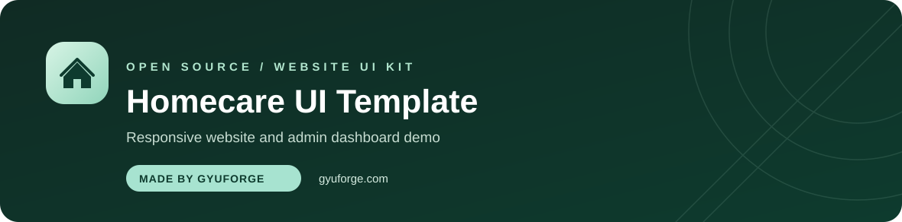
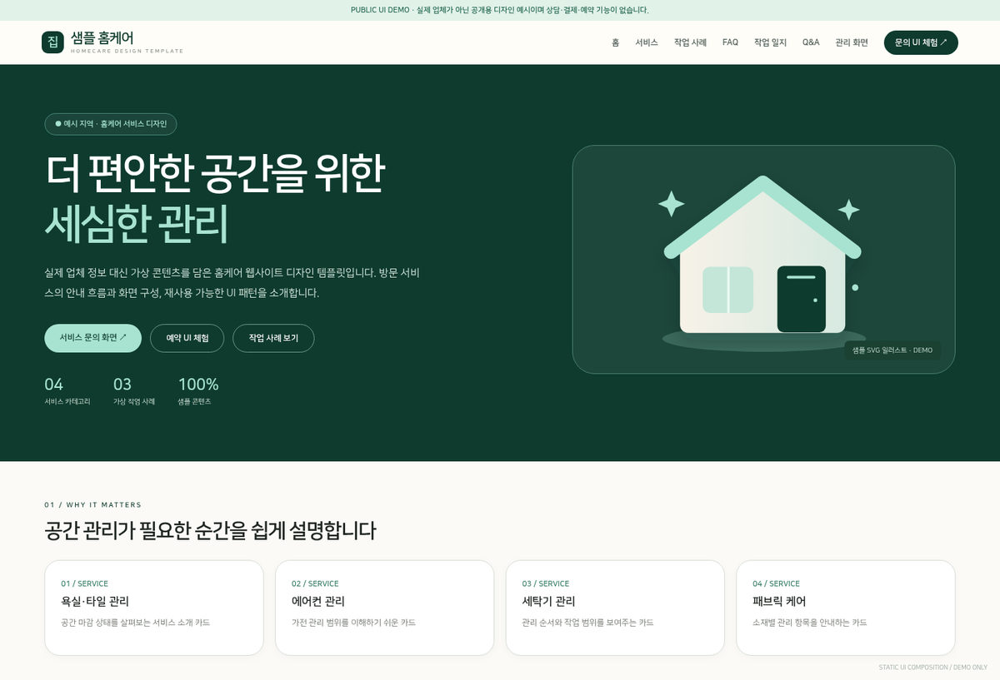
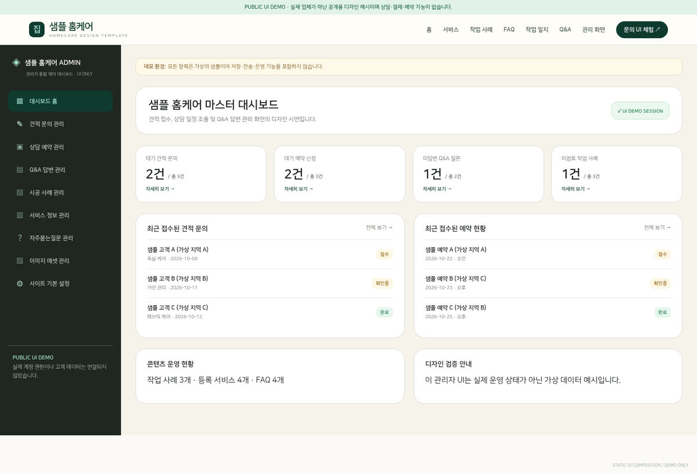
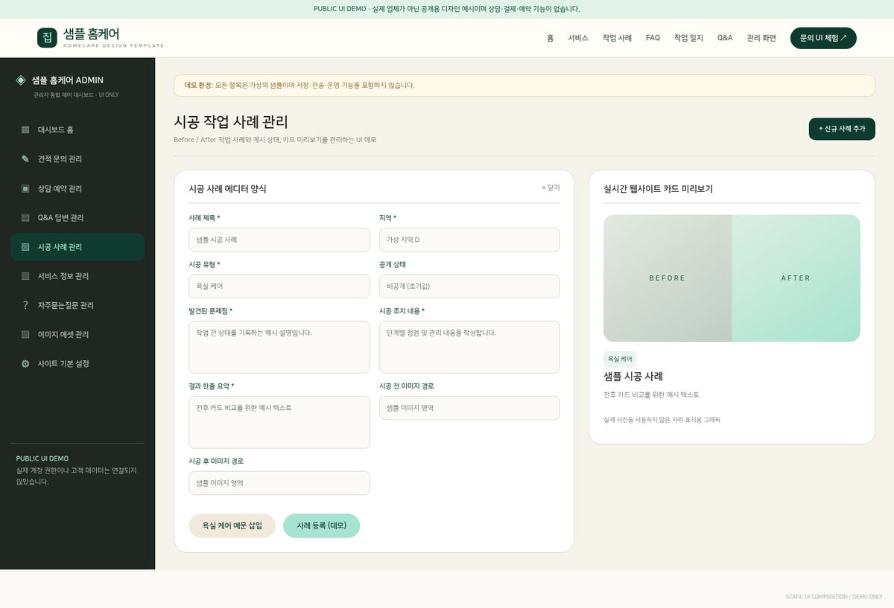

<div align="center">
  <a href="https://gyuforge.com/" title="GYUFORGE official website"></a>

  <h1>Homecare UI Template</h1>
  <p><b>Made by <a href="https://gyuforge.com/">GYUFORGE</a></b> · Responsive homecare website &amp; admin dashboard</p>
  <p><a href="https://homecare-ui-demo-public.vercel.app/">Live Demo</a> · <a href="https://homecare-ui-demo-public.vercel.app/admin">Admin Preview</a> · <a href="LICENSE">MIT License</a> · <a href="https://gyuforge.com/">gyuforge.com ↗</a></p>
</div>

**홈케어 서비스 웹사이트의 화면 구성과 디자인을 보여주는 공개용 Next.js 템플릿입니다.**

[라이브 UI 미리보기](https://homecare-ui-demo-public.vercel.app/) · [관리자 UI 미리보기](https://homecare-ui-demo-public.vercel.app/admin) · [MIT License](LICENSE)

> **UI 데모 전용:** 가상의 브랜드·문구·자료만 사용합니다. 로그인, 상담 접수, 예약, 결제, 실제 관리자 인증 및 영구 저장은 구현되지 않았습니다. 실제 서비스에 바로 배포하기 위한 완성형 제품이 아닙니다.

## UI 미리보기



| 관리자 대시보드 | 시공 사례 편집 UI |
| :---: | :---: |
|  |  |

스크린샷은 이 저장소에 포함된 정적 UI 컴포지션으로 생성한 **대표 시안**입니다. 실제 Next.js 앱 실행 결과를 E2E 검증한 캡처는 아닙니다. 디자인과 흐름을 확인하려면 위 라이브 데모를 이용하세요. 스크린샷은 `docs/screenshots/`, 캡처용 정적 HTML은 `docs/preview-fixture-*.html`에 있습니다.

## 3분 만에 실행하기

**준비물:** [Node.js](https://nodejs.org/) **20.9 이상** 및 npm

**방법 A — ZIP 파일로 실행 (Git을 몰라도 가능)**

1. 공개 저장소의 **Code → Download ZIP** 또는 제공된 압축파일을 다운로드합니다.
2. 압축을 풀고 폴더에서 터미널(PowerShell, Terminal 등)을 엽니다.
3. 아래 명령어 두 개를 차례대로 실행합니다.

```bash
npm install
npm run dev
```

4. 브라우저에서 **http://localhost:3000** 을 엽니다.

**방법 B — Git으로 실행**

```bash
git clone https://github.com/kutaelee/homecare-ui-template.git
cd homecare-ui-template
npm install
npm run dev
```

공개 저장소의 **Code → Download ZIP**을 눌러 Git 없이 내려받을 수도 있습니다.

**실행 종료:** 터미널에서 `Ctrl + C`

**테스트와 빌드**

```bash
npm run public-check   # 실제 브랜드·비밀키 패턴 및 필수 화면 구조 검사
npm run test           # 정적 검사 + ESLint + TypeScript 검사
npm run build          # 배포용 Next.js 빌드
npm run start          # 빌드한 앱 실행 (기본 3000번 포트)
```

`npm install`을 통해 패키지를 설치합니다. 이 저장소에 `package-lock.json`이 없는 상태라면 설치 결과가 의존성 업데이트에 따라 달라질 수 있습니다. 배포 환경에서는 lockfile을 생성·검증한 뒤 `npm ci`를 사용하는 것을 권장합니다.

## 구현 범위

| 영역 | 라우트 | 샘플 동작 |
|---|---|---|
| 메인 | `/` | Hero, 서비스 카드, 타임라인, FAQ |
| 서비스 | `/services`, `/services/[slug]` | 서비스 상세 UI |
| 사례 | `/cases`, `/cases/[id]` | Before/After 시각화 |
| 콘텐츠 | `/faq`, `/blog`, `/contact` | 정보형 카드·아코디언 |
| 상담 | `/inquiry/new`, `/reservation` | 입력 폼 UI, 서버 전송 없음 |
| Q&A | `/qna`, `/qna/[id]`, `/qna/new` | 샘플 질문·상세·작성 |
| 사용자 | `/login`, `/signup`, `/mypage` | 인증하지 않는 화면 예시 |
| 관리자 | `/admin`, `/admin/[section]` | 8개 관리 메뉴, 편집·상태 변경 시연 |
| 결제 | `/payment/mock-bank-transfer` | 결제 없이 화면만 표시 |
| 약관 | `/terms`, `/privacy` | 운영용이 아닌 자리 표시 |

관리자 메뉴는 견적 문의, 예약, Q&A, 시공 사례, 서비스 콘텐츠, FAQ, 미디어 에셋, 기본 설정으로 구성됩니다. 상태 변경과 편집은 브라우저 메모리에서만 반영되며 새로고침 시 사라집니다.

## 프로젝트 구성

```text
src/
  app/             # Next.js App Router 페이지
  components/      # 공유 UI / 관리자 화면
  data/            # 예시 콘텐츠와 가상 데이터
public/
  illustrations/   # 이 프로젝트용 샘플 SVG
docs/
  screenshots/     # README 미리보기 이미지
  preview-fixture-*.html
scripts/
  public-check.mjs # 공개 전 정적 점검
  structure-check.mjs
  render_static_previews.py
LICENSE
```

- **스타일 변경:** `src/app/globals.css`
- **문구·서비스 예시 변경:** `src/data/demo.ts`
- **관리자 데모 데이터 변경:** `src/data/adminDemo.ts`
- **관리자 UI 변경:** `src/components/AdminWorkspace.tsx`

디자인 토큰: Forest `#0E3B2E`, Mint `#A7E3D0`, Warm White `#FBFAF6`, Sand `#F1EADC`.

## 공개·보안 범위

- 원본 비공개 저장소의 `.git` 커밋 기록, 실제 사업 연락처, 블로그·카카오 상담 URL, 고객 데이터 및 수집 이미지를 복사하지 않았습니다.
- **기존 블로그 파서, 크롤러, RSS 피드 연결, 실제 네이버 블로그 URL은 포함되지 않습니다.** `/blog` 페이지는 가상 콘텐츠 카드입니다.
- `.env`, 인증 토큰, API Key, 데이터베이스 연결 및 백엔드 API를 요구하지 않습니다.
- `npm run public-check`는 패턴 검사일 뿐 전체 Git 기록, 바이너리 및 법적 권리 상태를 검증하는 보안 감사는 아닙니다.
- 이 프로젝트는 비공개 원본에서 분리해 작성한 독립 UI 시연물입니다. 원본 비공개 저장소를 Public으로 변경하거나 해당 이력을 그대로 복사하지 마세요.

**Git 이력:** 이 템플릿은 공개 저장소에서 별도로 관리합니다. 비공개 원본의 커밋 기록은 포함하지 않습니다.

## 라이선스

[MIT License](LICENSE) — Copyright © 2026 GYUTAE LEE. Project by [GYUFORGE](https://gyuforge.com/).

MIT는 이 공개용 템플릿의 직접 작성한 코드와 샘플 자산에 적용됩니다. 원본 비공개 프로젝트나 제3자 콘텐츠에 대한 권리를 이전하거나 허가하는 것은 아닙니다.
